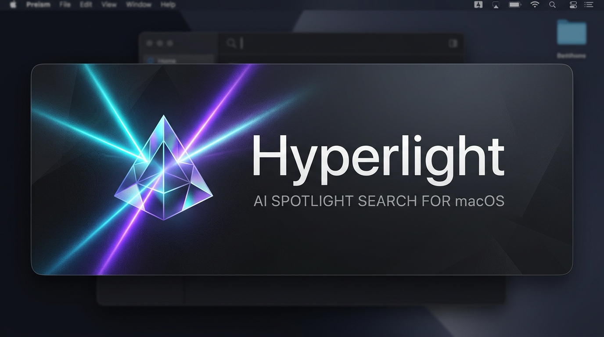
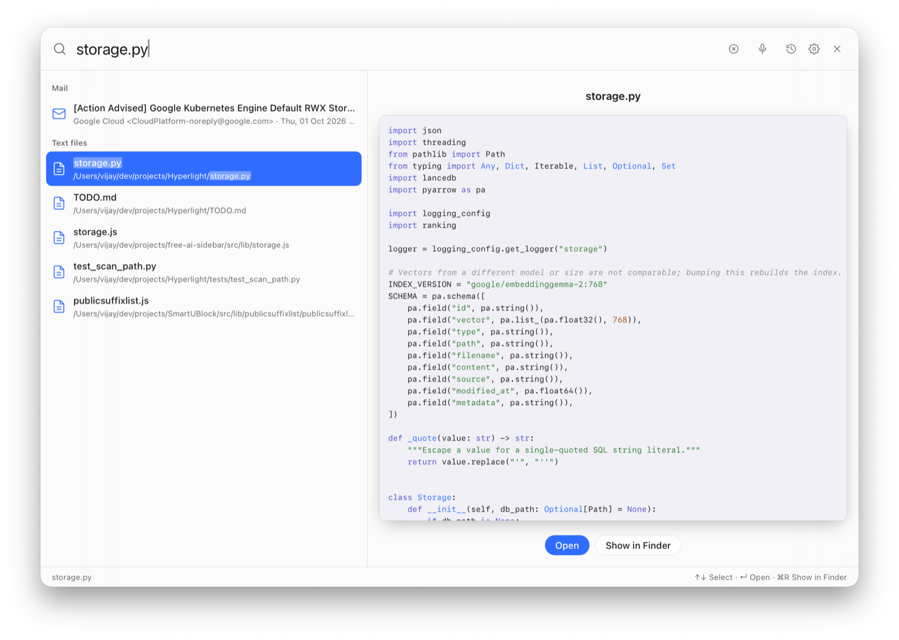
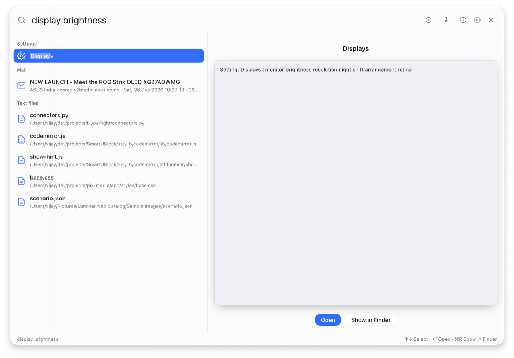
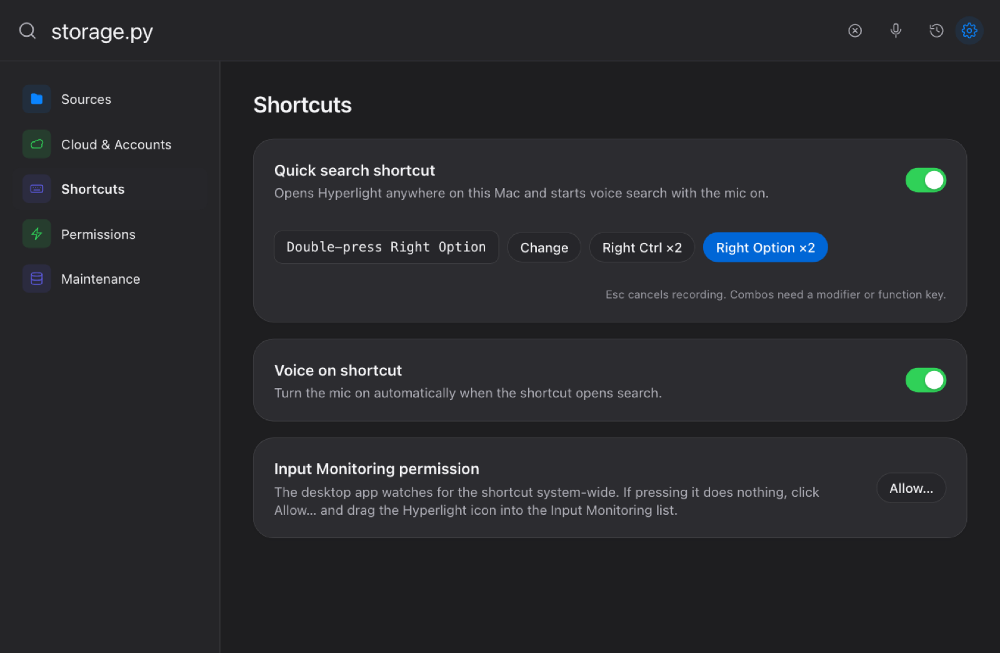
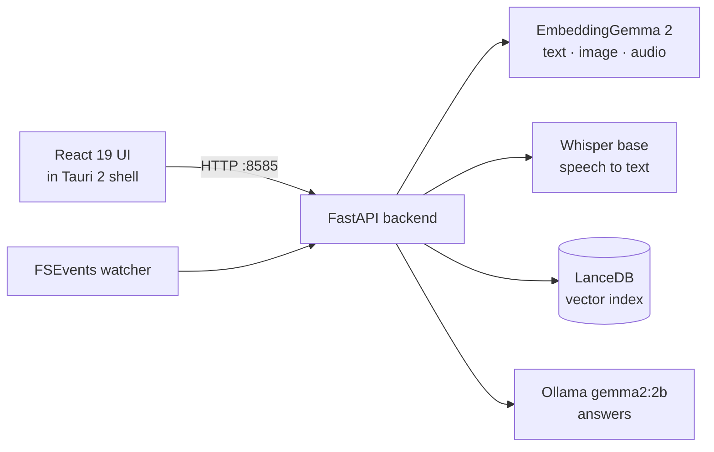

<h1 align="center">Hyperlight</h1>

<p align="center">
  <b>Private, on-device search for your Mac.</b><br>
  Find photos, documents, code, mail, settings and apps by describing them — or just saying them.<br>
  Nothing leaves your machine.
</p>

<p align="center">
  
  
  
  
</p>

---

Hyperlight is a Spotlight replacement for Apple Silicon. It lives in the menu bar, opens with a double-tap of Control, and understands text, images and speech in one search.


*Type a filename or describe what's inside. Code previews are syntax-highlighted.*


*System Settings panes are indexed too. "display brightness" finds Displays.*


*Pick your own global shortcut, choose whether the mic opens with it, and fix the Input Monitoring permission in one place. The UI follows light and dark mode.*

---

## ✨ Highlights

### 🔎 Search that understands meaning
- **One search for everything.** Documents, code, photos, mail, contacts, calendar events, bookmarks, System Settings and apps share a single semantic index. Type *"receipt from dinner"* or *"sunset at the beach"* and get the right photos and files.
- **Less noise.** Results must beat a relevance floor, so gibberish and filler words like *"the"* return nothing instead of random files.
- **Photos get their own lane.** Photos are ranked in a separate pool, so text hits never crowd them out. Up to 30 photos per search, 12 at first, with a "Show more" button.
- **Ask questions from the terminal.** `python3 cli.py ask "..."` sends the best matches to a local LLM (Gemma 2 through Ollama), which answers and cites its sources. If nothing relevant is found, it says so instead of guessing.

### 🎙️ Speak your search
- **Talk, pause, see results.** Press the hotkey and speak. Hyperlight searches when you pause, shows what it heard in the search box, and stops listening shortly after you finish.
- **Hold to talk.** Hold the hotkey while speaking and let go to finish. A quick tap toggles the mic instead.
- **Noise-proof.** Silence, background noise and non-speech never trigger a search.
- **Calm results.** Previous results stay on screen, dimmed, while the next search runs. Results only change when the transcript does.
- See [How voice search works](#-how-voice-search-works) for the details.

### 👀 Rich previews
- **Quick Look previews** for PDF, Word, PowerPoint, Excel, Keynote, Pages, Numbers, RTF and images.
- **Formatted text.** Markdown renders with headings and lists, JSON is pretty-printed, CSV shows as a table, and code is syntax-highlighted.

### 🍎 Native Mac experience
- **Menu bar app.** No Dock icon. Open, Voice Search, History, Settings, Open at Login, Restart and Quit are one click away.
- **Global hotkey.** Double-tap Control, or record your own shortcut. Pressing it again hides Hyperlight. Hyperlight checks the Input Monitoring permission and helps you grant it.
- **Frameless glass window** with hide-on-close and macOS vibrancy. Built on Tauri 2 and React 19.

### 📂 Sources
- **Local folders** and network volumes, indexed in parallel with incremental rescans.
- **Live scanning.** macOS FSEvents index new and changed files within moments and remove deleted ones. One master switch, plus a switch per source.
- **iCloud Drive** and **Google Drive** (through Drive for desktop).
- **Apple Mail.** Hyperlight asks for Full Disk Access when it needs it.
- **System Settings** panes, so *"wifi"* or *"dark mode"* opens the right pane.
- **Skips the junk.** Minified bundles, lock files, tokenizer dumps, `.app` bundles and Photos library caches stay out of the index.
- **Sign in with Google** for Photos, Drive and Gmail is coming soon.

### 🔒 Private by design
- Embeddings, vector search, speech recognition and question answering all run on your Mac.
- No file content goes to a cloud AI service.
- **Locked-down local API.** The backend listens on `127.0.0.1:8585` only and rejects foreign Host and Origin headers, so a web page cannot read your files. Previews, thumbnails and *Open* only work for files that are in your index.
- **Credentials stay yours.** Google tokens are stored owner-only (`0600`), and OAuth sign-in is protected with a one-time `state` check.
- **Safe re-scans.** A re-scan keeps your existing results until the new pass succeeds, and removing a source stops its scan first.

---

## 🎙️ How voice search works

**Attempt one: audio straight into the embedding model.** EmbeddingGemma 2 can embed raw audio, so the first version sent the recording directly to it and searched with that vector — no transcription at all. It did an *average* job:

- Clear, distinctive phrases like *"passport"* worked.
- Everyday queries such as *"wifi settings"* and *"receipt amazon"* missed.
- Silence still matched random files, because an audio vector always lands *somewhere*.
- The model returns only a vector, **no text**. There was nothing to show the user about what it heard, so a wrong result was impossible to understand.

**What ships now: Whisper + Gemma together.** Hyperlight uses open-source [OpenAI Whisper](https://github.com/openai/whisper) (`base`, 139 MB, runs locally on CPU) for the words, and keeps the audio too:

```
mic ──► 16 kHz capture (AudioWorklet) ──► pause detected
          │
          ▼
   Whisper transcript ──► no speech? ──► stop, show nothing
          │
          ▼
   EmbeddingGemma 2:  encode({ text: transcript, audio: clip })  ──► one joint vector
          │
          ▼
   vector search + transcript words as a ranking boost ──► results + "what I heard"
```

- **One joint vector.** Transcript and audio are embedded *together*. When Whisper mishears (*"invoice"* → *"in voice"*), the audio still pulls the search toward the right meaning. Averaging two separate vectors measured worse.
- **Words boost, never gate.** Transcript words lift matching files, but can't push a weak match past the relevance floor — a misheard word shouldn't drag in junk.
- **Silence rejection.** Low energy, Whisper's `no_speech_prob`, or an empty transcript returns no results.
- **Warm start.** Whisper loads the moment the mic opens, so the first search doesn't pay the load cost.

Measured with `tools/eval_voice.py` (synthetic `say` clips, ~450 ms per search):

| Spoken | Heard | Top result |
| :--- | :--- | :--- |
| passport | Passport. | the passport PDF |
| wifi settings | Wi-Fi settings. | Wi-Fi settings pane |
| receipt amazon | Recit Amazon. | Amazon payment receipt mail |
| meeting tomorrow | meeting tomorrow. | "Reschedule Meeting" mail |
| *silence / noise* | — | nothing (by design) |

---

## 🧠 How ranking works

Embedding models have "hub" items — short or generic files that sit close to *every* query. Hyperlight scores each candidate by how much closer it is to your query than to a set of filler queries (*"the"*, *"something"*, *"lorem ipsum"*…). Files that match everything get no credit for matching you.

On top of that relevance score:
- A **floor** per modality drops anything that isn't clearly relevant.
- **Word and filename matches** add a bonus. Lookups like `storage.py` or `A-302` weigh filenames more.
- Intent words like *"photos"* or *"pictures"* are ignored for word matching.

---

## 🏗️ Under the hood



| Layer | Technology |
| :--- | :--- |
| Embeddings | [EmbeddingGemma 2](https://huggingface.co/google/embeddinggemma-2) (768-d) through `sentence-transformers`, PyTorch on Apple Silicon (MPS) |
| Vector store | [LanceDB](https://lancedb.github.io/lancedb/) with Apache Arrow batch writes |
| Speech | [OpenAI Whisper](https://github.com/openai/whisper) (`base`), open source, run locally |
| Question answering | [Ollama](https://ollama.com/) running `gemma2:2b` |
| Backend | Python 3.12, FastAPI, Uvicorn, `watchdog` (FSEvents) |
| Desktop shell | [Tauri 2](https://v2.tauri.app/) (Rust) with tray, global hotkey and autostart |
| Frontend | React 19, TypeScript, Vite, CSS Modules, Tailwind CSS |

---

## 🚀 Get started

### Prerequisites
- macOS on Apple Silicon
- Python 3.12 or later
- [Bun](https://bun.sh/) and [Rust](https://rustup.rs/)
- [Ollama](https://ollama.com/), then `ollama pull gemma2:2b`

### Set up
```bash
python3 -m venv .venv
source .venv/bin/activate
uv pip install fastapi uvicorn lancedb pyarrow sentence-transformers torch openai-whisper watchdog pillow pypdf python-docx

cd frontend
bun install
bun run build
cd ..
```

### Run the desktop app
```bash
./dev-app.sh
```
This starts the backend on port 8585, builds the Tauri shell, signs it and opens one window. Do not run `tauri dev` at the same time.

### Run the web app
```bash
python3 web_app.py
# open http://127.0.0.1:8585
```

### Run the tests
```bash
uv pip install -r requirements-dev.txt
python -m pytest -q
cd frontend && bunx tsc -b && bun run lint
```
CI runs the same checks on every push and pull request.

### Use the command line
```bash
python3 cli.py index ~/Documents
python3 cli.py search "tax return 2024"
python3 cli.py ask "What was my deductible on last year's insurance?"
python3 cli.py status
```

### Evaluate voice search
```bash
PYTHONPATH=. .venv/bin/python tools/eval_voice.py            # synthetic clips
PYTHONPATH=. .venv/bin/python tools/eval_voice.py ~/my-clips # plus your own 16 kHz WAVs
```

---

## ⌨️ Keyboard

| Key | Action |
| :--- | :--- |
| Double-tap Control | Show Hyperlight, or hide it when it is already in front |
| Double-tap Control, then speak | Voice search |
| Double-tap and hold Control | Hold to talk; release to finish |
| ↑ / ↓ | Move through results |
| Return | Open the selected result |
| ⌘R | Reveal in Finder |
| ⌘K | Focus search |
| ⌘, | Open or close Settings |
| Esc | Clear the search. The mic keeps recording. |
| Esc Esc | Stop the mic and cancel the voice search |

---

## 📦 Releases

Pushing a tag such as `v0.1.0-beta.2` builds the Tauri app on GitHub Actions and publishes a prerelease. Beta builds bundle the Python backend inside the app, so the DMG runs standalone on Apple Silicon with no repository or `.venv`.

The build is ad-hoc signed, not notarized, so Gatekeeper blocks the first launch. After dragging Hyperlight to Applications, run once in Terminal, then open it normally:

```
xattr -cr /Applications/Hyperlight.app
```

Chat answers need Ollama running locally; search and indexing work without it. Models download on first use.

## 📝 Project notes

- [PLAN.md](PLAN.md) holds the architecture and decisions.
- [TODO.md](TODO.md) holds open work.
